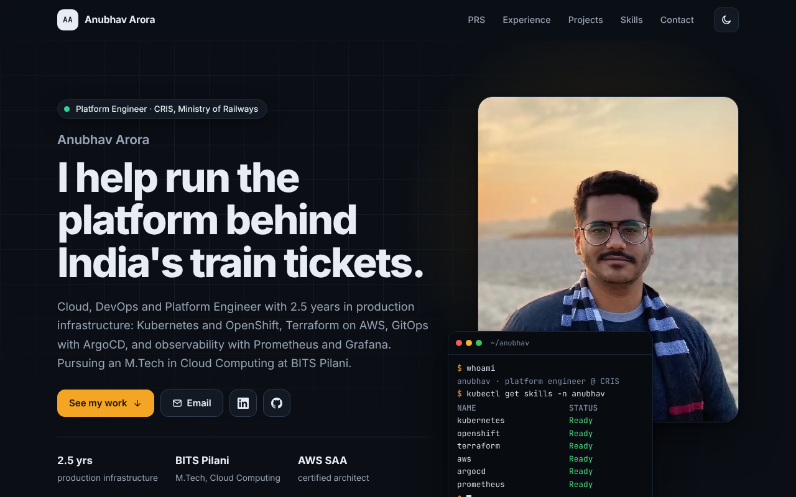

<div align="center">

# Anubhav Arora

**Cloud, DevOps & Platform Engineer** · Platform Engineer at CRIS (Indian Railways) · M.Tech Cloud Computing, BITS Pilani

### [anubhav1941.github.io](https://anubhav1941.github.io)

[LinkedIn](https://www.linkedin.com/in/anubhavarora-devops/) · [GitHub](https://github.com/anubhav1941) · [Email](mailto:anubhav1941@gmail.com)

[](https://github.com/anubhav1941/anubhav1941.github.io/actions/workflows/pages.yml)

<a href="https://anubhav1941.github.io"></a>

</div>

This is the source of my portfolio site. The site is the thing to look at; this repo is how it's built.

## How it's built

- **One YAML file** (`content/profile.yaml`) holds all the text. A short Python script (`build.py`) renders it through Jinja2 templates into plain HTML. There's no framework and no client-side build step.
- **Light and dark themes**, mobile-first, and checked with an accessibility scanner (axe) in both themes.
- **Architecture diagrams** are hand-written inline SVG, so they follow the theme and stay sharp at any size.
- **Tests** check the built site: every link and asset resolves, images have alt text, share-preview tags exist, **no phone number is published**, and **the photos carry no EXIF/GPS metadata**.
- **GitHub Actions** runs the tests, builds the site and deploys it to GitHub Pages on every push to `main`. Pull requests run the tests and the build without deploying.

```
content/profile.yaml ──▶ build.py (Jinja2) ──▶ _site/ ──▶ GitHub Pages
templates/*.j2 ────────────┘     static/ (CSS, JS, images) copied as is
```

## Run it locally

```bash
python -m venv .venv && source .venv/bin/activate
pip install -r requirements.txt
python -m pytest -q          # builds the site and checks it
python build.py              # writes _site/
python -m http.server -d _site 8000
```

To change the content, edit `content/profile.yaml`. The share-preview image (`static/img/og.png`) is a 1200×630 screenshot of `tools/og.html`.

## Projects featured on the site

| Project | What it shows |
|---|---|
| [railbook-deploy](https://github.com/anubhav1941/railbook-deploy) (+ [inventory-service](https://github.com/anubhav1941/inventory-service), [booking-service](https://github.com/anubhav1941/booking-service)) | Microservices on Kubernetes: booking saga, seat locking, HPA, CI |
| [terraform-aws-infra](https://github.com/anubhav1941/terraform-aws-infra) | Terraform modules, dev/prod, locked remote state, CI |
| [devops-3tier-ecommerce-pipeline](https://github.com/anubhav1941/devops-3tier-ecommerce-pipeline) | GitOps on AWS EKS: Jenkins, ArgoCD, cert-manager |
